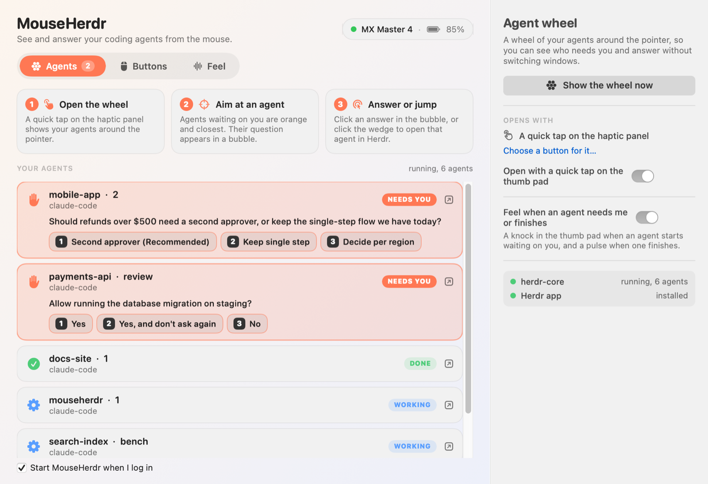
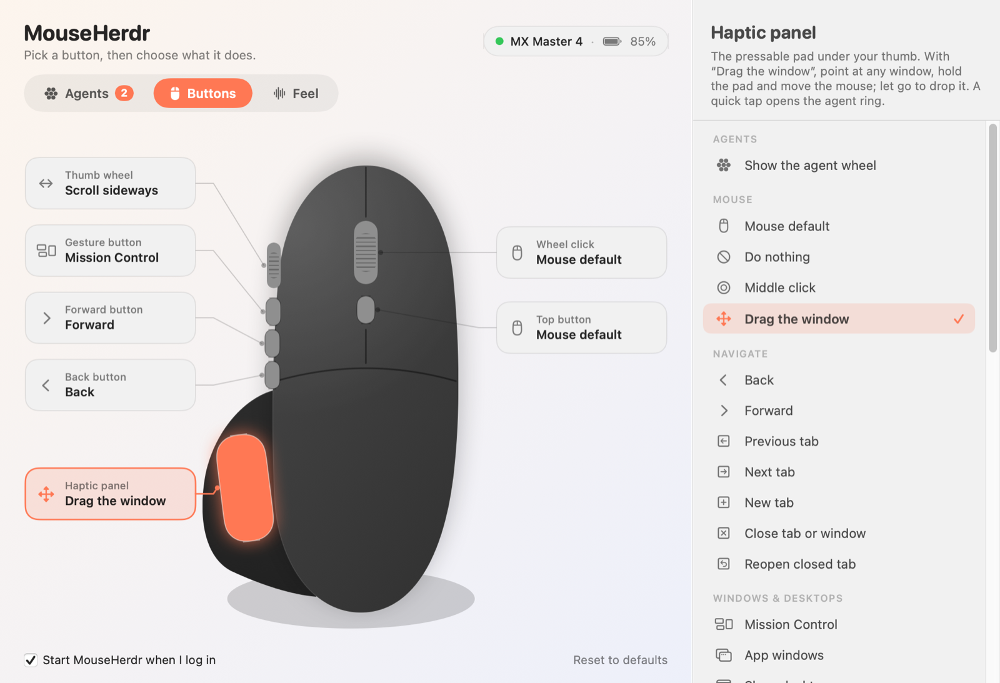

# MouseHerdr

[](https://mouseherdr.dev/)

A small, friendly macOS menu bar app for your mouse. Pick a button on a picture of the
mouse, choose what it does, and you're done. It can show and answer your coding agents from
a wheel around the pointer, opened with a button on the mouse.

It was built for the Logitech MX Master 4, the one mouse it supports in full: every button,
the thumb wheel and the haptic motor. It talks to that mouse directly, so it does not need
Logi Options+. It also [recognises some 60 other mice](#other-mice) from Apple, Logitech,
Microsoft, Razer and others, and on any mouse with a wheel that clicks, that click can open
the agent wheel.

<a href="https://youtu.be/76AmPMwFGJI" target="_blank" rel="noopener noreferrer">
  
</a>

Click the GIF to watch **MouseHerdr: Welcome to My Herd** on YouTube
(⌘/Ctrl-click to open in a new tab).

## What it does

**Buttons**





- Assign any of the wheel click, top button, gesture button, forward, back and haptic panel
  to an action: back/forward, tabs, Mission Control, desktops, copy/paste, media keys,
  screenshots, lock screen, a keyboard shortcut you record, or opening an app.
- The gesture button has five actions: click, and hold-and-move up, down, left or right.
- The thumb wheel can scroll sideways (default) or control volume, tabs, zoom, desktops, or
  undo/redo.

**Windows**

- Hold the haptic panel and move the mouse to drag the window under the pointer, whether or
  not it is the active one. Let go to drop it.
- While dragging, push into a screen edge to snap: left or right for half the screen, the
  top for full, a corner for a quarter.

**Haptics**

- A bump when a dragged window reaches a snap edge or a gesture fires.
- Optional: a tick when the pointer crosses into or out of a window, and a fainter one when
  it lands on something clickable.

**Coding agents (optional, needs [Herdr](https://herdr.dev))**

- Tap the haptic panel to see your agents in a wheel around the pointer; on
  [another mouse](#other-mice), press the scroll wheel. Agents waiting on you are orange,
  wider, and closest.
- Aim at one and click its wedge to jump to it in the Herdr app.
- You need not aim at all. The middle of the wheel, where the pointer rests as it opens,
  stands for one agent: the one that most recently started waiting on you, or else the
  latest one. That agent is picked out as the wheel appears and, if it is waiting, its
  question is already showing. Click the middle to open it.
- To put the wheel away, right-click the middle, press Escape, or press the button that
  opened it again. Escape goes no further: the app in front does not see it.
- The most recently active agents come first. A busy agent says how long its turn has run
  ("working 5m") and a quiet one how long ago it was active ("3h ago"). Quiet agents fade
  to grey and get thinner and shorter, so the busy ones stand out; point at one and it
  grows back.
- Right-click a wedge to pin that agent: pinned agents stay near the front at full size.
  The Agents page has a pin button on each agent too.
- A small pill on a wedge counts the sub-agents that agent has busy, as herdr-core reports
  them: terminals it started with `hc run`, and sub-agents it runs inside itself. A
  sub-agent gets a wedge of its own only when it is waiting on you.
- Every agent gets a wedge. On a crowded wheel they all get thinner, and the one you point
  at grows wide enough to read.
- When a Herdr space has several sessions, each wedge also says what its session is about.
  The Agents page can order the wheel by space instead, which keeps every agent in its
  place and puts a space's sessions side by side under its name.
- If it asked a question, a speech bubble shows it. Each offered choice is a button you can
  click to answer without leaving what you're doing; hovering a choice shows its
  explanation, and "Type your own answer…" opens a small text box.
- The choice you clicked is blue while the answer is on its way and turns green once the
  agent has it. herdr-core delivers an answer when that agent's terminal has had about
  3 seconds without typing or pointer movement, so it can take a moment if you were just
  busy there. The wheel keeps the pointer from the window underneath while it is up, and
  if you close it before the answer has gone in, it stays a moment longer until it has.
- When an agent asks to run something risky ("Do you want to proceed?"), the bubble shows
  the exact command and the agent's own choices, such as Yes, Yes and don't ask again, and
  No, so you can approve or refuse it from the mouse.
- A knock in the thumb pad when an agent starts waiting on you, and a pulse when one
  finishes.

The window has three pages. **Agents** comes first: it lists your agents with what each
is asking, lets you answer or open one, and has a button to show the wheel. **Buttons** is
the mouse picture for assigning actions, including "Show the agent wheel" for any button.
**Feel** holds the haptic and window-snapping switches. Beside the app's name the window
says which version is running and, for a build made from a checkout, the commit it was
built from, so that two builds on one Mac can be told apart.

### Other mice


MouseHerdr works out which mouse is connected, whatever its make, and shows its name and
picture on the Buttons page. It notices a mouse the moment it is plugged in or paired.

- **The wheel click opens the agent wheel.** On every mouse except the MX Master 4, pressing
  the scroll wheel shows your agents, in place of a middle click. The first time a mouse is
  found, a notice says which button was set and invites you to try it. To get the middle
  click back or use another button, pick it on the Buttons page.
- **Back and forward buttons** go back and forward, and can be given any other action.
- **A mouse with no spare button**, such as Apple's Magic Mouse or Microsoft's Arc Mouse, is
  told so. Use **Show Agent Wheel** in the menu bar icon's menu instead.
- **Each mouse keeps its own settings.** A button you changed on the MX Master 4 starts out
  the same on a new mouse that has that button. After that the two go their own ways.
- **One mouse is followed at a time.** macOS does not say which mouse a click came from, so
  the settings of the mouse being followed apply to the wheel click, back and forward of
  every connected mouse. An MX Master 4 is followed whenever it is connected; otherwise a
  recognised mouse comes before an unknown one, and among equals the one that connected
  last. To follow another, choose it under **Change…**; **Follow automatically** there
  hands the choice back. A Bluetooth mouse drops its link while it naps, so another mouse
  that takes over is given a few seconds before anything is said about it.


**Change…** on the Buttons page lists the mice connected now and every model MouseHerdr
knows, with a search field. Pick yours if MouseHerdr got it wrong. A mouse on a USB receiver
(Logitech Unifying, Bolt or Lightspeed, or a Microsoft transceiver) does not say what it is,
so it gets a plain layout until you pick its model. **Detect again** forgets what you picked
and looks afresh.

A mouse that is not in the list still works. It is shown under the name it reports, with a
plain layout that fits the number of buttons it declares: a wheel click, and back and
forward if it has side buttons.

#### Recognised mice


| Brand | Models |
| --- | --- |
| Apple | Magic Mouse, Apple Mouse |
| Logitech | MX Master 4, 3S, 3, 2S and the original; MX Anywhere 2, 2S, 3 and 3S; MX Vertical; Lift; MX Ergo; Ergo M575; M570; M720 Triathlon; Signature M650; M585 and M590; M705 Marathon; M510; Pebble; POP Mouse; M185, M235 and M325; G502; G Pro and Pro X Superlight; G203 and G102; G305 and G304; G403 and G703; G903 and G900 |
| Microsoft | Basic Optical Mouse; Bluetooth Mouse, Modern Mobile Mouse and their kin; Arc Mouse; Bluetooth Ergonomic Mouse; Surface Precision Mouse; Sculpt Ergonomic and Sculpt Comfort; Classic and Pro IntelliMouse; Comfort Mouse 4500 |
| Razer | DeathAdder, Viper, Basilisk, Naga, Pro Click, Pro Click V2 Vertical, Orochi, Cobra |
| SteelSeries | Rival, Aerox, Prime, Sensei |
| Corsair | M65, Harpoon, Katar, Dark Core, Ironclaw, Nightsword |
| Others | Glorious Model O and Model D; Zowie; Keychron M series; Kensington Expert Mouse and SlimBlade; Elecom EX-G; Evoluent VerticalMouse; Satechi M1; Dell MS116; HP and Lenovo USB optical mice |

**Only the MX Master 4 has been tested on the device.** The others are recognised from
published device ids and from the names they report. Recognising, though not the buttons,
has also been checked against a Microsoft Basic Optical Mouse and a Logitech Unifying
receiver. These mice use only what macOS reports for any mouse: the wheel click and the
back and forward buttons. Extra buttons that need the maker's software (DPI buttons, a
Naga's thumb keys) are not available. Logitech's other MX mice, connected over Bluetooth,
also offer their gesture button and the button behind the wheel over the same direct link
the MX Master 4 uses; that is built from the control ids Solaar lists for those mice and has
not been tried on them, so a button the mouse does not report is shown as unavailable. If a
recognised mouse behaves differently from what is described here, please
[open an issue](https://github.com/royosherove/mouse-herdr/issues).

## Requirements

- macOS 13 or later (developed and tested on macOS 26, Apple silicon)
- Xcode command line tools (Swift 5.9 or later), only when building from source
- A mouse. A Logitech MX Master 4 connected over **Bluetooth** gets every feature. Any
  other mouse, over USB or Bluetooth, gets [the basics](#other-mice).

There are no third-party Swift packages, required accounts, or API keys. Herdr is only
needed for the optional coding-agent features. Release downloads run on Apple silicon
and Intel; mouse hardware testing has been on Apple silicon, with an MX Master 4.

The direct link to the mouse (the MX Master 4's top button, real hold and release on its
haptic panel, haptics and battery level) works over Bluetooth only. Through a Logi Bolt or
Unifying USB receiver a mouse is seen as "a mouse on a receiver", with its wheel click, back
and forward buttons, until you pick its model. One exception keeps an earlier setup
working: on a Mac that ran MouseHerdr before it recognised other mice, the mouse behind a
Bolt receiver is still taken for an MX Master 4, as it was then. See
[Adding a mouse](#adding-a-mouse) to give a mouse its own picture and buttons.

## Install

[Download the latest Mac app](https://github.com/royosherove/mouse-herdr/releases/latest/download/MouseHerdr.zip),
[build from source](#build-from-source), or
[give your agent the build prompt](#building-from-source-for-agents).

### Download a release

Changes to the app or its build inputs are published after CI passes on `main`.
Documentation, tests, and CI-only changes do not create new releases.
Each [release](https://github.com/royosherove/mouse-herdr/releases/latest) contains one app
for both Apple silicon and Intel.

1. Download **MouseHerdr.zip** using the link above and unzip it.
2. Quit any running MouseHerdr, then drag **MouseHerdr.app** to **Applications**. Replace
   the older copy if you are updating; your assignments remain saved.
3. Open MouseHerdr from Applications. macOS may ask you to confirm opening an app
   downloaded from the internet.
4. [Grant **Accessibility** and **Input Monitoring**](#grant-permissions), then quit and
   reopen MouseHerdr.

New releases are **Developer ID signed and notarized by Apple**, with the notarization
ticket included in the app. Releases published before signing was enabled remain ad-hoc
signed; check their release notes. When upgrading from one of those releases or a source
build, you may need to remove and re-add the Applications copy in Accessibility and Input
Monitoring because its signing identity has changed.

To check a download, save `MouseHerdr.zip.sha256` from the same release beside the ZIP,
then run `shasum -a 256 -c MouseHerdr.zip.sha256` in that directory.

Maintainers: [release signing setup](docs/release-signing.md).

### Automatic updates

Signed releases check for updates daily and download them in the background by default.
When an update is ready, choose **Restart to Update** in the menu bar or **Settings**.
The update also installs when you next quit MouseHerdr. Your assignments and settings
stay saved, and **What’s New** opens after the update with offline release notes.

In **Settings**, uncheck **Automatically check for and download updates** to stop future
automatic checks and downloads. An already prepared update still installs on quit.
**Check for Updates…** remains available for manual checks. **What’s New…** is also
available from the menu bar and Settings.

Updates use Sparkle to verify the signed feed and download before installing the signed
app. Older releases without the updater need one manual download to get this feature.

A build made from source never checks for an update or installs one by itself. To move it
to the public release, choose **Install Latest Release…** in **Settings** or the menu bar.
MouseHerdr shows the latest release, downloads it when you agree, verifies it the same
way, puts it in the build's place and restarts. From then on it updates itself like any
release. Your button assignments stay saved. The release is signed by its developer rather
than on your Mac, so [grant Accessibility and Input Monitoring](#grant-permissions) again
afterwards, removing the older MouseHerdr entries first if macOS still lists them.

### Build from source

Install Apple's command line tools if you have not already, then finish the installer:

```bash
xcode-select --install
```

Check that `swift --version` reports Swift 5.9 or newer, then:

```bash
git clone https://github.com/royosherove/mouse-herdr.git
cd mouse-herdr
./build.sh install
```

This builds the app, copies it to `/Applications/MouseHerdr.app` and starts it. The first
start opens the window; after that it starts quietly in the menu bar and at login.
You can turn off **Start MouseHerdr when I log in** in Settings. Run the build as your
normal user, without `sudo`; if Applications needs administrator approval, copy
`dist/MouseHerdr.app` there with Finder and open it.

Source builds use a local signing identity. An Apple Developer account is not required.
This does not produce an Apple-notarized app for redistribution.

### Grant permissions

In the app's setup panel, grant these two permissions under **System Settings → Privacy
& Security**:

| Permission | Why |
| --- | --- |
| Accessibility | To press shortcuts for you and move windows. Required. |
| Input Monitoring | To talk to the mouse directly. Needed for the top button, real hold and release on the haptic panel, haptics, and battery level. Only asked for with a Logitech mouse on Bluetooth that has such buttons. |

If MouseHerdr does not appear in the Input Monitoring list, click **+** there and choose it
from Applications. Quit and reopen MouseHerdr after granting Input Monitoring, or use its
relaunch button. Working out which mouse is connected needs neither permission.

### Building from source for agents

Paste this entire prompt into an agent that can run commands on your Mac:

```text
Build and install MouseHerdr on this Mac from https://github.com/royosherove/mouse-herdr.

1. Check that this is macOS 13 or newer and that Apple's command line tools provide
   Swift 5.9 or newer. Use xcode-select -p and swift --version. If tools are missing,
   run xcode-select --install and tell me to finish Apple's installer before continuing.

2. Use my existing MouseHerdr checkout if there is one. Otherwise clone the repository
   into a persistent folder, such as ~/Developer/mouse-herdr. Read its README,
   CONTRIBUTING.md, and build.sh. If an existing checkout is clean, update it with
   git pull --ff-only. Preserve any local edits, local.env, and signing/ directory.

3. Build as my normal user, without sudo. Use the default local signing mode,
   SIGNING=local, and keep any existing bundle identifier and signing identity.
   Check whether local.env overrides those settings; do not replace an established
   identity. A new install can use the default dev.mouseherdr.app identifier.
   Run swift test, python3 scripts/test_release.py, and SIGNING=local ./build.sh install.
   If Applications requires administrator approval, tell me to copy
   dist/MouseHerdr.app there with Finder and open it.

4. Verify /Applications/MouseHerdr.app with codesign --verify --strict, and report the
   installed version and any errors. Guide me through granting Accessibility and
   Input Monitoring in System Settings > Privacy & Security, then relaunching the app.
   Explain that an MX Master 4 must connect over Bluetooth for its extra buttons and
   haptics, and that any other mouse works over USB or Bluetooth with its wheel click
   and side buttons. Run /Applications/MouseHerdr.app/Contents/MacOS/MouseHerdr
   --detect-mice and tell me which mouse it found. I will grant the permissions and
   check the physical mouse myself.

5. Herdr is optional; do not install it unless I ask. Keep this checkout and signing/
   so future updates can use git pull --ff-only followed by ./build.sh install without
   changing the signing identity. Finish with the app location and any manual steps.
```

### Set up the agent wheel (optional)

Install the [Herdr desktop app](https://github.com/herdrdev/herdr-app#install) separately;
its shell installer also installs herdr-core. Start the app and open a coding-agent
session there. MouseHerdr uses the `hc` command from herdr-core to list agents and send
answers; `herdr-app` and the desktop app are used to focus an agent's terminal.

The app looks for these commands in `~/.local/bin`, `/opt/homebrew/bin`, `/usr/local/bin`
and `~/.cargo/bin`. Install the commands in one of those locations if your terminal can
find them but MouseHerdr cannot. Check the connection without starting the mouse remapper:

```bash
/Applications/MouseHerdr.app/Contents/MacOS/MouseHerdr --herdr-status
```

The **Agents** page shows whether Herdr is missing, stopped, or running without agents.
MouseHerdr rechecks while it runs, so installing or starting Herdr does not need a
MouseHerdr restart. To use MouseHerdr without Herdr, turn off the thumb-pad tap and agent
haptics on that page; the mouse controls, window dragging and other haptics work separately.

### Update a source build

Keep the same checkout and its `signing/` directory, then run:

```bash
git pull --ff-only
./build.sh install
```

The installer quits the running copy before replacing it. Your assignments and preferences
remain in your user Library.

To stop building it yourself, choose **Install Latest Release…** in Settings instead: see
[Automatic updates](#automatic-updates).

### What the build script does

- Builds with `swift build` and assembles `dist/MouseHerdr.app`.
- Signs the app with a self-signed certificate it creates in `signing/` (not committed), so
  macOS keeps your permissions across rebuilds. To make that certificate findable it adds
  that keychain file to your keychain search list. Keep the signing files private.
- Uses the app identifier `dev.mouseherdr.app`. To customize the build, copy
  `local.env.example` to `local.env` and edit it. Keep your chosen identifier stable after
  granting permissions. `local.env` is ignored by Git and is sourced as shell code.
- Verifies the app's signature before installation and stops if any build step fails.

For a build without installing or launching the remapper, run `./build.sh`. For a disposable
test build that leaves your keychains alone, run `SIGNING=adhoc ./build.sh` (ensure
`local.env` does not override it). Ad-hoc signing does not preserve permissions across
rebuilds. See [CONTRIBUTING.md](CONTRIBUTING.md) for tests and hardware checks.

### Troubleshooting

| Symptom | What to check |
| --- | --- |
| No window after starting | Click the mouse icon in the menu bar, then **Open MouseHerdr…**. Closing the window leaves remapping running. |
| Buttons do nothing | Grant Accessibility to the copy in Applications. Quit other mouse remappers, including Logi Options+. |
| The wrong mouse, or no mouse, is shown | On the Buttons page choose **Change…**, then your mouse under **Connected now** or your model in the list. `--detect-mice` (below) prints what MouseHerdr sees. A trackpad is not counted as a mouse. |
| The wheel click no longer middle-clicks | On a mouse other than the MX Master 4 it opens the agent wheel. On the Buttons page select **Wheel click** and choose **Mouse default**, then give the wheel to another button if you like. |
| A mouse on a USB receiver shows a plain picture | The receiver hides the model. Choose **Change…** and pick it from the list. |
| Top button, haptics or battery unavailable | Connect over Bluetooth, grant Input Monitoring, then relaunch MouseHerdr. A Bolt receiver will not work. |
| Permissions were granted but stopped working after rebuilding | Keep the same bundle identifier and signing identity. Remove the old app entry from the affected privacy list, add the current Applications copy, and relaunch. |
| `swift` is missing or too old | Install or update Xcode command line tools, then check `xcode-select -p` and `swift --version`. |
| Local signing fails | Retry the build and check its error output. If initial keychain creation was interrupted, follow the signing cleanup below and rebuild; macOS permissions will need granting again. |
| Agent wheel has no agents | Run `--herdr-status` above, check the Herdr setup section, and start an agent in Herdr. |

To see which mice MouseHerdr finds and which one it would follow, without starting the
remapper or asking for any permission:

```bash
/Applications/MouseHerdr.app/Contents/MacOS/MouseHerdr --detect-mice
```

Add `--watch 30` to keep looking for 30 seconds while you plug a mouse in or switch it on.

For a bug report, include your macOS version, Mac architecture, mouse model, connection
type, `swift --version`, the output of `--detect-mice`, and the relevant error. Review logs
for personal information before sharing them. See [CONTRIBUTING.md](CONTRIBUTING.md).

### Uninstall and signing cleanup

Turn off **Start MouseHerdr when I log in**, then quit from the menu bar. Delete
`/Applications/MouseHerdr.app`, `~/Library/Application Support/MouseHerdr` and
`~/Library/Logs/MouseHerdr.log`. Remove MouseHerdr from Login Items and the two privacy
lists in System Settings. To also clear its UI preferences, run
`defaults delete dev.mouseherdr.app` (substitute your identifier if you customized it).

To remove the generated signing identity, run these commands from the original checkout
before deleting the project directory:

```bash
security delete-keychain "$PWD/signing/mouseherdr.keychain-db"
rm -rf signing
```

Skip signing cleanup if you intend to keep rebuilding with the same permissions.

## Good to know

- Remaps of the wheel click, back and forward apply to any mouse connected to the Mac:
  macOS does not say which mouse a click came from. MouseHerdr follows one mouse at a time
  and uses that mouse's settings.
- Quitting from the menu bar hands every button back to the mouse.
- Running Logi Options+ at the same time will fight over the buttons. Use one or the other.
- "Feel what's clickable" asks each app what is under the pointer, which can slow
  Chromium-based apps slightly. Turn it off if you notice.
- Settings are in `~/Library/Application Support/MouseHerdr`: `config.json` holds the
  MX Master 4's buttons, `mice/` has a file for each other mouse, and `mice.json` remembers
  which mice have been met and what you picked for them. The log is at
  `~/Library/Logs/MouseHerdr.log`.

## Privacy

MouseHerdr has no telemetry or built-in network requests. Remapping, window inspection and
settings stay on your Mac. With agent features enabled, it reads agent status, titles,
questions and terminal text through the locally installed Herdr tools, and sends answers
through those tools when you choose to reply. Herdr and your coding agents have their own
network behavior.

To recognise a mouse, MouseHerdr reads what each connected pointing device reports about
itself: its vendor and product ids, its name, how it is connected and how many buttons it
declares. It opens none of them and sends nothing anywhere.

MouseHerdr does not read the keyboard, with one exception: while the agent wheel is
showing, key presses pass through it so that it can tell when Escape is pressed and put the
wheel away. It acts on no other key, keeps and logs none, and stops the moment the wheel
closes.

Logs can contain application names, agent workspace/tab names, button events, local paths
and the names of connected mice. A Bluetooth mouse's name can include its owner's, as in
"Sam's Magic Mouse". Typed answers are logged by character count, not their contents. Review logs and
screenshots before posting them. See [SECURITY.md](SECURITY.md) for private vulnerability
reporting.

## How it works

- `HIDPP.swift` speaks Logitech's HID++ 2.0 protocol over the mouse's Bluetooth vendor
  channel: it captures ("diverts") the buttons macOS never sees, reads the battery, and
  plays the built-in haptic waveforms.
- `ActionRunner.swift` watches the ordinary extra buttons and the thumb wheel with an event
  tap, and performs actions by posting key and media events.
- `MouseProfile.swift` describes what a mouse is: how to recognise it, its controls, where
  their presses come from, its defaults and its picture. In `Profiles/`, `MXMaster4.swift`
  is a mouse drawn and described by hand, `Catalog.swift` lists the other mice a line each,
  and `Bodies.swift` has the shapes those are drawn from.
- `MouseDetector.swift` lists the mice connected to the Mac, of any make, and hears them
  come and go. It reads what each device reports about itself without opening it, so it
  needs no permission. It also decides which one to follow and which profile it gets.
- `MouseSetup.swift` decides what to say about a newly found mouse; `MousePicker.swift` is
  the notice and the list of mice in the window.
- `AppState.swift` follows the chosen mouse, ties its controls to actions and holds the
  window dragging and snapping.
- `Feel.swift` has the hover and window-edge detection and the snap preview.
- `Agents.swift` reads agent state from `hc` (herdr-core), draws the wheel and speech
  bubble, and sends answers back with `hc keys` and `hc send`.
- `MouseView.swift` and `ContentView.swift` are the SwiftUI window, drawn from the profile.

## Adding a mouse

Everything specific to one mouse lives in a `MouseProfile`. First find out what the mouse
reports. With it connected, run:

```bash
dist/MouseHerdr.app/Contents/MacOS/MouseHerdr --detect-mice
```

It prints each mouse's vendor and product id, its name, how many buttons it declares, and
the profile it gets now. `--identify 045e:00cb "Microsoft USB Optical Mouse"` asks the same
about a mouse you don't have to hand, and `--list-mice` prints every profile.

### A mouse with the usual buttons

A mouse that has a wheel click, perhaps back and forward buttons, and a shape like many
others is one line in `Sources/MouseHerdr/Profiles/Catalog.swift`:

```swift
mouse("razerViper", razer, "Viper", ids: [0x0078, 0x007A], names: ["Razer Viper"], .ambi, .wheelAndSides),
```

- The first three values are its `id` (also the name of its settings file), its brand and
  its name.
- `ids` are HID product ids, which count together with the brand's vendor ids. `names` are
  parts of the name the mouse reports. Either is enough; when several names fit, the longest
  wins. Say in the pull request where an id comes from.
- Then the body it is drawn from (`.plain`, `.compact`, `.sculpted`, `.gaming`, `.ambi`,
  `.vertical`, `.thumbBall`, `.fingerBall`, `.magic` or `.arc` in `Bodies.swift`, in another
  colour with `.finished(.silver)`) and its buttons: `.wheel`, `.wheelAndSides`,
  `.wheelAndBack`, `.none` for a mouse with no spare button, and a few for Logitech's MX
  mice.
- A new brand needs a `Brand` with its vendor ids, and its name in `brands`.

Such a mouse is recognised, not tested: leave `tested` alone. The tests in
`MouseCatalogTests.swift` check that no two mice claim the same id or name and that every
drawing and its labels fit; add what your mouse reports to `sightings` there.

### A mouse with a shape or controls of its own

1. Copy `Sources/MouseHerdr/Profiles/MXMaster4.swift` to a new file in the same folder and
   rename the static property, `id` and `name`. Set `brand`, and `vendorIDs` if it is not a
   Logitech mouse.
2. Say how to recognise it: `productIDs` (HID product ids, which count together with
   `vendorIDs`) and/or `nameContains` (parts of the name the mouse reports).
3. List its `controls`. Each one has:
   - `slot`: the key its action is saved under. Reuse the existing `Slot` cases (`middle`,
     `back`, `forward`, `gesture`, `modeShift`, `thumbPanel`, `thumbWheel`) so settings carry
     over between mice.
   - `title` and `blurb`: what the window calls it.
   - `source`: `.button(n)` for a button macOS reports itself (2 wheel click, 3 back,
     4 forward; the log shows the number of any button you press), `.hidpp(cid:)` for a
     control only reachable over HID++, `.button(n, cid:)` if it is both, or `.thumbWheel`.
     The log lists every control id the mouse reports as `control cid=0x….`.
   - `gestures: true` on at most one control, for hold-and-move in four directions.
   - `rect`, `shape`, `chip` and `chipOnLeft`: where it is on the picture, how it is drawn,
     and where its label goes.
4. Fill in `firstSelected`, `hasHaptics`, `defaults` (an action per slot), `directLinkWhy`
   (the sentence shown next to the Input Monitoring permission) and `art`: the canvas size,
   the body outline, an optional second shape behind it, the seam lines and the floor shadow.
   Keep the lower right corner of the canvas free: the mouse's name goes there.
5. Add it to `MouseProfile.all` in `MouseProfile.swift`. Set `tested: true` only once it
   has been checked on the device.

### Checking the drawing

Without the mouse: `./build.sh`, then
`dist/MouseHerdr.app/Contents/MacOS/MouseHerdr --snapshot /tmp/mouse.png --profile <id>`
(add `--dark`, `--gesture` or `--wheel` for other views, `--notice` for what is said when
the mouse is first found, and `--picker` for the list of mice).
`--snapshot-mice /tmp/mice.png` draws every mouse on one sheet.

## Acknowledgements

The HID++ feature and function numbers were learned from the documentation and source of
[Solaar](https://github.com/pwr-Solaar/Solaar), the Linux device manager for Logitech
devices. No Solaar code is included.

The device ids that other mice are recognised by were collected from the Linux kernel's HID
drivers, Solaar, [libratbag](https://github.com/libratbag/libratbag),
[OpenRazer](https://github.com/openrazer/openrazer),
[rivalcfg](https://github.com/flozz/rivalcfg), [ckb-next](https://github.com/ckb-next/ckb-next)
and the [USB ID Repository](http://www.linux-usb.org/usb-ids.html). No code from them is
included.

## Disclaimer

This is an independent project. It is not affiliated with, endorsed by, or supported by
Logitech, Apple, Microsoft, Razer, any other maker of the mice it recognises, or Herdr.
Product names are trademarks of their owners. It sends commands to your mouse and presses
keys on your behalf; use it at your own risk.

## License

[MIT](LICENSE)
