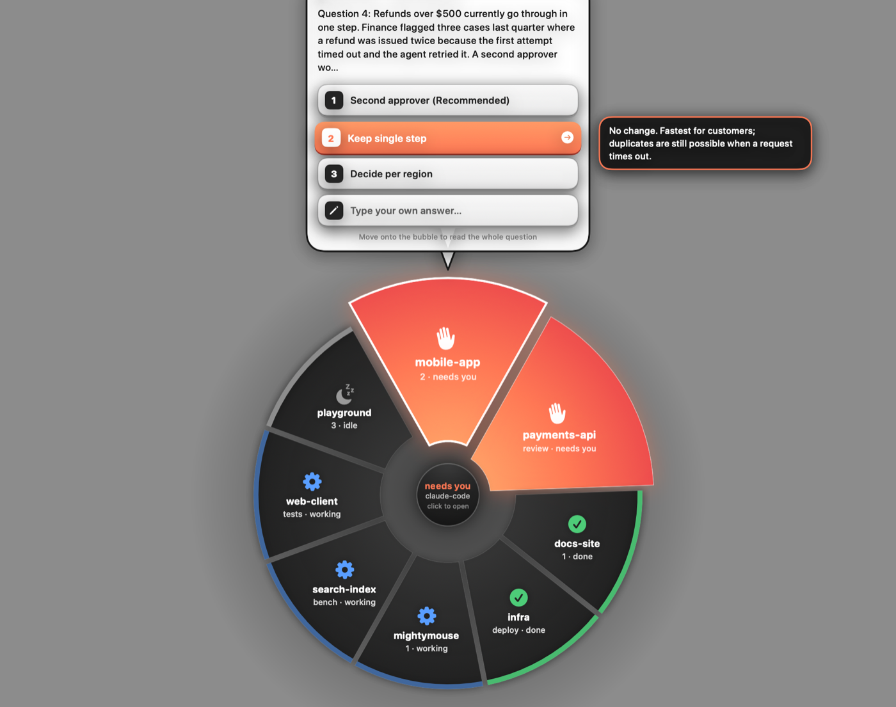

# MightyMouse

A small, friendly macOS menu bar app for the Logitech MX Master 4. Pick a button on a
picture of the mouse, choose what it does, and you're done. It also uses the mouse's haptic
motor, and it can show and answer your coding agents from a wheel around the pointer.

It talks to the mouse directly, so it does not need Logi Options+.


## What it does

**Buttons**

- Assign any of the wheel click, top button, gesture button, forward, back and haptic panel
  to an action: back/forward, tabs, Mission Control, desktops, copy/paste, media keys,
  screenshots, lock screen, a keyboard shortcut you record, or opening an app.
- The gesture button has five actions: click, and hold-and-move up, down, left or right.
- The thumb wheel can scroll sideways (default) or control volume, tabs, zoom, desktops, or
  undo/redo.

**Windows**

- Hold the haptic panel and move the mouse to drag the window under the pointer, whether or
  not it is the active one. Let go to drop it.
- While dragging, push into a screen edge to snap: left or right for half the screen, the
  top for full, a corner for a quarter.

**Haptics**

- A bump when a dragged window reaches a snap edge or a gesture fires.
- Optional: a tick when the pointer crosses into or out of a window, and a fainter one when
  it lands on something clickable.

**Coding agents (optional, needs [Herdr](https://herdr.dev))**



- Tap the haptic panel to see your agents in a wheel around the pointer. Agents waiting on
  you are orange, wider, and closest.
- Aim at one and click its wedge to jump to it in the Herdr app.
- If it asked a question, a speech bubble shows it. Each offered choice is a button you can
  click to answer without leaving what you're doing; hovering a choice shows its
  explanation, and "Type your own answer…" opens a small text box.
- A knock in the thumb pad when an agent starts waiting on you, and a pulse when one
  finishes.

Everything optional has a switch under **Haptics & extras** in the window.

## Requirements

- macOS 13 or later (developed and tested on macOS 26, Apple silicon)
- Xcode command line tools (Swift 5.9 or later) to build
- A Logitech MX Master 4 connected over **Bluetooth**

The Logi Bolt USB receiver is not supported. Other Logitech mice may partly work but are
untested; the mouse picture and button names are for the MX Master 4.

## Install

```bash
git clone <this repository>
cd mightymouse
./build.sh install
```

This builds the app, copies it to `/Applications/MightyMouse.app` and starts it. The first
start opens the window; after that it starts quietly in the menu bar and at login.

macOS will ask for two permissions:

| Permission | Why |
| --- | --- |
| Accessibility | To press shortcuts for you and move windows. Required. |
| Input Monitoring | To talk to the mouse directly. Needed for the top button, real hold and release on the haptic panel, haptics, and battery level. |

If MightyMouse does not appear in the Input Monitoring list, click **+** there and choose it
from Applications.

### What the build script does

- Builds with `swift build` and assembles `dist/MightyMouse.app`.
- Signs the app with a self-signed certificate it creates in `signing/` (not committed), so
  macOS keeps your permissions across rebuilds. To make that certificate findable it adds
  that keychain file to your keychain search list.
- Uses the app identifier `dev.mightymouse.app`. To use your own, put
  `BUNDLE_ID=your.own.id` in a file called `local.env`. macOS ties permissions and settings
  to the identifier, so pick one and keep it.

To remove everything: quit from the menu bar, delete `/Applications/MightyMouse.app`,
`~/Library/Application Support/MightyMouse` and `~/Library/Logs/MightyMouse.log`, and remove
MightyMouse from Login Items and the two privacy lists in System Settings.

## Good to know

- Remaps of the wheel click, back and forward apply to any mouse connected to the Mac.
- Quitting from the menu bar hands every button back to the mouse.
- Running Logi Options+ at the same time will fight over the buttons. Use one or the other.
- "Feel what's clickable" asks each app what is under the pointer, which can slow
  Chromium-based apps slightly. Turn it off if you notice.
- Settings are in `~/Library/Application Support/MightyMouse/config.json`. The log is at
  `~/Library/Logs/MightyMouse.log`.

## How it works

- `HIDPP.swift` speaks Logitech's HID++ 2.0 protocol over the mouse's Bluetooth vendor
  channel: it captures ("diverts") the buttons macOS never sees, reads the battery, and
  plays the built-in haptic waveforms.
- `ActionRunner.swift` watches the ordinary extra buttons and the thumb wheel with an event
  tap, and performs actions by posting key and media events.
- `AppState.swift` ties buttons to actions and holds the window dragging and snapping.
- `Feel.swift` has the hover and window-edge detection and the snap preview.
- `Agents.swift` reads agent state from `hc` (herdr-core), draws the wheel and speech
  bubble, and sends answers back with `hc keys` and `hc send`.
- `MouseView.swift` and `ContentView.swift` are the SwiftUI window.

## Acknowledgements

The HID++ feature and function numbers were learned from the documentation and source of
[Solaar](https://github.com/pwr-Solaar/Solaar), the Linux device manager for Logitech
devices. No Solaar code is included.

## Disclaimer

This is an independent project. It is not affiliated with, endorsed by, or supported by
Logitech, Apple, or Herdr. Product names are trademarks of their owners. It sends commands
to your mouse and presses keys on your behalf; use it at your own risk.

## License

[MIT](LICENSE)
