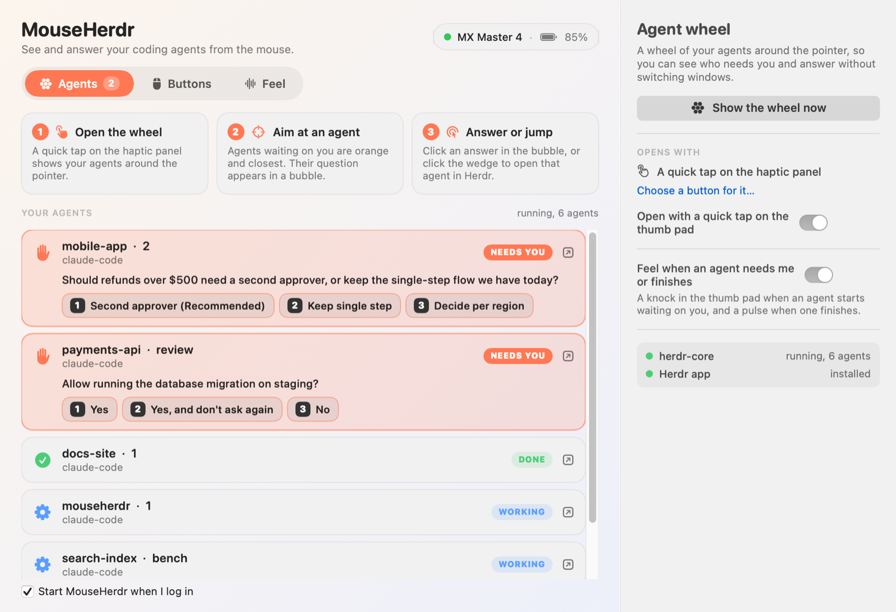
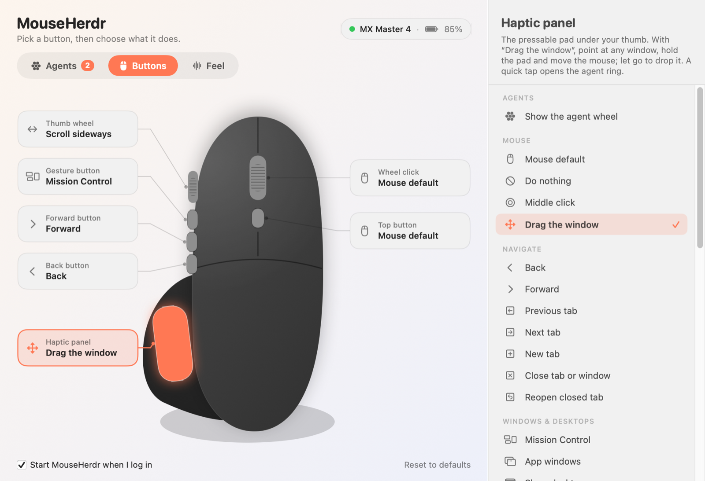

# MouseHerdr

A small, friendly macOS menu bar app for the Logitech MX Master 4. Pick a button on a
picture of the mouse, choose what it does, and you're done. It also uses the mouse's haptic
motor, and it can show and answer your coding agents from a wheel around the pointer.

It talks to the mouse directly, so it does not need Logi Options+.

<a href="https://youtu.be/76AmPMwFGJI" target="_blank" rel="noopener noreferrer">
  
</a>

Click the GIF to watch **MouseHerdr: Welcome to My Herd** on YouTube
(⌘/Ctrl-click to open in a new tab).

## What it does

**Buttons**





- Assign any of the wheel click, top button, gesture button, forward, back and haptic panel
  to an action: back/forward, tabs, Mission Control, desktops, copy/paste, media keys,
  screenshots, lock screen, a keyboard shortcut you record, or opening an app.
- The gesture button has five actions: click, and hold-and-move up, down, left or right.
- The thumb wheel can scroll sideways (default) or control volume, tabs, zoom, desktops, or
  undo/redo.

**Windows**

- Hold the haptic panel and move the mouse to drag the window under the pointer, whether or
  not it is the active one. Let go to drop it.
- While dragging, push into a screen edge to snap: left or right for half the screen, the
  top for full, a corner for a quarter.

**Haptics**

- A bump when a dragged window reaches a snap edge or a gesture fires.
- Optional: a tick when the pointer crosses into or out of a window, and a fainter one when
  it lands on something clickable.

**Coding agents (optional, needs [Herdr](https://herdr.dev))**

- Tap the haptic panel to see your agents in a wheel around the pointer. Agents waiting on
  you are orange, wider, and closest.
- Aim at one and click its wedge to jump to it in the Herdr app.
- If it asked a question, a speech bubble shows it. Each offered choice is a button you can
  click to answer without leaving what you're doing; hovering a choice shows its
  explanation, and "Type your own answer…" opens a small text box.
- A knock in the thumb pad when an agent starts waiting on you, and a pulse when one
  finishes.

The window has three pages. **Agents** comes first: it lists your agents with what each
is asking, lets you answer or open one, and has a button to show the wheel. **Buttons** is
the mouse picture for assigning actions, including "Show the agent wheel" for any button.
**Feel** holds the haptic and window-snapping switches.

## Requirements

- macOS 13 or later (developed and tested on macOS 26, Apple silicon)
- Xcode command line tools (Swift 5.9 or later), only when building from source
- A Logitech MX Master 4 connected over **Bluetooth**

There are no third-party Swift packages, required accounts, or API keys. Herdr is only
needed for the optional coding-agent features. Release downloads run on Apple silicon
and Intel; mouse hardware testing has been on Apple silicon.

The Logi Bolt USB receiver is not supported. Other Logitech Bluetooth mice that expose the
same HID++ interface fall back to a "Generic mouse" with only the wheel click, back and
forward buttons; these devices are untested. See [Adding a mouse](#adding-a-mouse) to give
one its own picture and buttons.

## Install

[Download the latest Mac app](https://github.com/royosherove/mouse-herdr/releases/latest/download/MouseHerdr.zip),
[build from source](#build-from-source), or
[give your agent the build prompt](#building-from-source-for-agents).

### Download a release

Changes to the app or its build inputs are published after CI passes on `main`.
Documentation, tests, and CI-only changes do not create new releases.
Each [release](https://github.com/royosherove/mouse-herdr/releases/latest) contains one app
for both Apple silicon and Intel.

1. Download **MouseHerdr.zip** using the link above and unzip it.
2. Quit any running MouseHerdr, then drag **MouseHerdr.app** to **Applications**. Replace
   the older copy if you are updating; your assignments remain saved.
3. Open MouseHerdr from Applications. If macOS blocks it, go to **System Settings →
   Privacy & Security**, find MouseHerdr under Security, and choose **Open Anyway**.
4. [Grant **Accessibility** and **Input Monitoring**](#grant-permissions), then quit and
   reopen MouseHerdr.

These downloads are ad-hoc signed and **not notarized by Apple**. The Open Anyway step
allows this particular app. Updates may require granting the permissions again; remove
and re-add the Applications copy if necessary. Building from source creates a stable local
signing identity that you can keep across updates.

To check a download, save `MouseHerdr.zip.sha256` from the same release beside the ZIP,
then run `shasum -a 256 -c MouseHerdr.zip.sha256` in that directory.

### Build from source

Install Apple's command line tools if you have not already, then finish the installer:

```bash
xcode-select --install
```

Check that `swift --version` reports Swift 5.9 or newer, then:

```bash
git clone https://github.com/royosherove/mouse-herdr.git
cd mouse-herdr
./build.sh install
```

This builds the app, copies it to `/Applications/MouseHerdr.app` and starts it. The first
start opens the window; after that it starts quietly in the menu bar and at login.
You can turn off **Start MouseHerdr when I log in** in the window. Run the build as your
normal user, without `sudo`; if Applications needs administrator approval, copy
`dist/MouseHerdr.app` there with Finder and open it.

Source builds use a local signing identity. An Apple Developer account is not required.
This does not produce an Apple-notarized app for redistribution.

### Grant permissions

In the app's setup panel, grant these two permissions under **System Settings → Privacy
& Security**:

| Permission | Why |
| --- | --- |
| Accessibility | To press shortcuts for you and move windows. Required. |
| Input Monitoring | To talk to the mouse directly. Needed for the top button, real hold and release on the haptic panel, haptics, and battery level. |

If MouseHerdr does not appear in the Input Monitoring list, click **+** there and choose it
from Applications. Quit and reopen MouseHerdr after granting Input Monitoring, or use its
relaunch button.

### Building from source for agents

Paste this entire prompt into an agent that can run commands on your Mac:

```text
Build and install MouseHerdr on this Mac from https://github.com/royosherove/mouse-herdr.

1. Check that this is macOS 13 or newer and that Apple's command line tools provide
   Swift 5.9 or newer. Use xcode-select -p and swift --version. If tools are missing,
   run xcode-select --install and tell me to finish Apple's installer before continuing.

2. Use my existing MouseHerdr checkout if there is one. Otherwise clone the repository
   into a persistent folder, such as ~/Developer/mouse-herdr. Read its README,
   CONTRIBUTING.md, and build.sh. If an existing checkout is clean, update it with
   git pull --ff-only. Preserve any local edits, local.env, and signing/ directory.

3. Build as my normal user, without sudo. Use the default local signing mode,
   SIGNING=local, and keep any existing bundle identifier and signing identity.
   Check whether local.env overrides those settings; do not replace an established
   identity. A new install can use the default dev.mouseherdr.app identifier.
   Run swift test, python3 scripts/test_release.py, and SIGNING=local ./build.sh install.
   If Applications requires administrator approval, tell me to copy
   dist/MouseHerdr.app there with Finder and open it.

4. Verify /Applications/MouseHerdr.app with codesign --verify --strict, and report the
   installed version and any errors. Guide me through granting Accessibility and
   Input Monitoring in System Settings > Privacy & Security, then relaunching the app.
   Explain that the mouse must connect over Bluetooth. I will grant the permissions
   and check the physical mouse myself.

5. Herdr is optional; do not install it unless I ask. Keep this checkout and signing/
   so future updates can use git pull --ff-only followed by ./build.sh install without
   changing the signing identity. Finish with the app location and any manual steps.
```

### Set up the agent wheel (optional)

Install the [Herdr desktop app](https://github.com/herdrdev/herdr-app#install) separately;
its shell installer also installs herdr-core. Start the app and open a coding-agent
session there. MouseHerdr uses the `hc` command from herdr-core to list agents and send
answers; `herdr-app` and the desktop app are used to focus an agent's terminal.

The app looks for these commands in `~/.local/bin`, `/opt/homebrew/bin`, `/usr/local/bin`
and `~/.cargo/bin`. Install the commands in one of those locations if your terminal can
find them but MouseHerdr cannot. Check the connection without starting the mouse remapper:

```bash
/Applications/MouseHerdr.app/Contents/MacOS/MouseHerdr --herdr-status
```

The **Agents** page shows whether Herdr is missing, stopped, or running without agents.
MouseHerdr rechecks while it runs, so installing or starting Herdr does not need a
MouseHerdr restart. To use MouseHerdr without Herdr, turn off the thumb-pad tap and agent
haptics on that page; the mouse controls, window dragging and other haptics work separately.

### Update a source build

Keep the same checkout and its `signing/` directory, then run:

```bash
git pull --ff-only
./build.sh install
```

The installer quits the running copy before replacing it. Your assignments and preferences
remain in your user Library.

### What the build script does

- Builds with `swift build` and assembles `dist/MouseHerdr.app`.
- Signs the app with a self-signed certificate it creates in `signing/` (not committed), so
  macOS keeps your permissions across rebuilds. To make that certificate findable it adds
  that keychain file to your keychain search list. Keep the signing files private.
- Uses the app identifier `dev.mouseherdr.app`. To customize the build, copy
  `local.env.example` to `local.env` and edit it. Keep your chosen identifier stable after
  granting permissions. `local.env` is ignored by Git and is sourced as shell code.
- Verifies the app's signature before installation and stops if any build step fails.

For a build without installing or launching the remapper, run `./build.sh`. For a disposable
test build that leaves your keychains alone, run `SIGNING=adhoc ./build.sh` (ensure
`local.env` does not override it). Ad-hoc signing does not preserve permissions across
rebuilds. See [CONTRIBUTING.md](CONTRIBUTING.md) for tests and hardware checks.

### Troubleshooting

| Symptom | What to check |
| --- | --- |
| No window after starting | Click the mouse icon in the menu bar, then **Open MouseHerdr…**. Closing the window leaves remapping running. |
| Buttons do nothing | Grant Accessibility to the copy in Applications. Quit other mouse remappers, including Logi Options+. |
| Top button, haptics or battery unavailable | Connect over Bluetooth, grant Input Monitoring, then relaunch MouseHerdr. A Bolt receiver will not work. |
| Permissions were granted but stopped working after rebuilding | Keep the same bundle identifier and signing identity. Remove the old app entry from the affected privacy list, add the current Applications copy, and relaunch. |
| `swift` is missing or too old | Install or update Xcode command line tools, then check `xcode-select -p` and `swift --version`. |
| Local signing fails | Retry the build and check its error output. If initial keychain creation was interrupted, follow the signing cleanup below and rebuild; macOS permissions will need granting again. |
| Agent wheel has no agents | Run `--herdr-status` above, check the Herdr setup section, and start an agent in Herdr. |

For a bug report, include your macOS version, Mac architecture, mouse model, connection
type, `swift --version`, and the relevant error. Review logs for personal information
before sharing them. See [CONTRIBUTING.md](CONTRIBUTING.md).

### Uninstall and signing cleanup

Turn off **Start MouseHerdr when I log in**, then quit from the menu bar. Delete
`/Applications/MouseHerdr.app`, `~/Library/Application Support/MouseHerdr` and
`~/Library/Logs/MouseHerdr.log`. Remove MouseHerdr from Login Items and the two privacy
lists in System Settings. To also clear its UI preferences, run
`defaults delete dev.mouseherdr.app` (substitute your identifier if you customized it).

To remove the generated signing identity, run these commands from the original checkout
before deleting the project directory:

```bash
security delete-keychain "$PWD/signing/mouseherdr.keychain-db"
rm -rf signing
```

Skip signing cleanup if you intend to keep rebuilding with the same permissions.

## Good to know

- Remaps of the wheel click, back and forward apply to any mouse connected to the Mac.
- Quitting from the menu bar hands every button back to the mouse.
- Running Logi Options+ at the same time will fight over the buttons. Use one or the other.
- "Feel what's clickable" asks each app what is under the pointer, which can slow
  Chromium-based apps slightly. Turn it off if you notice.
- Settings are in `~/Library/Application Support/MouseHerdr/config.json`. The log is at
  `~/Library/Logs/MouseHerdr.log`.

## Privacy

MouseHerdr has no telemetry or built-in network requests. Remapping, window inspection and
settings stay on your Mac. With agent features enabled, it reads agent status, titles,
questions and terminal text through the locally installed Herdr tools, and sends answers
through those tools when you choose to reply. Herdr and your coding agents have their own
network behavior.

Logs can contain application names, agent workspace/tab names, button events and local
paths. Typed answers are logged by character count, not their contents. Review logs and
screenshots before posting them. See [SECURITY.md](SECURITY.md) for private vulnerability
reporting.

## How it works

- `HIDPP.swift` speaks Logitech's HID++ 2.0 protocol over the mouse's Bluetooth vendor
  channel: it captures ("diverts") the buttons macOS never sees, reads the battery, and
  plays the built-in haptic waveforms.
- `ActionRunner.swift` watches the ordinary extra buttons and the thumb wheel with an event
  tap, and performs actions by posting key and media events.
- `MouseProfile.swift` describes what a mouse is: its controls, where their presses come
  from, its defaults and its picture. `Profiles/` has one file per mouse.
- `AppState.swift` picks the profile for the connected mouse, ties its controls to actions and
  holds the window dragging and snapping.
- `Feel.swift` has the hover and window-edge detection and the snap preview.
- `Agents.swift` reads agent state from `hc` (herdr-core), draws the wheel and speech
  bubble, and sends answers back with `hc keys` and `hc send`.
- `MouseView.swift` and `ContentView.swift` are the SwiftUI window, drawn from the profile.

## Adding a mouse

Everything specific to one mouse lives in a `MouseProfile`. To add one:

1. Copy `Sources/MouseHerdr/Profiles/MXMaster4.swift` (or the smaller `Generic.swift`) to a
   new file in the same folder and rename the static property, `id` and `name`.
2. Say how to recognise it: `productIDs` (the HID product id; MouseHerdr writes it to the log
   as `found … (product id 0x….)` when the mouse connects) and/or `nameContains` (part of the
   name the mouse reports).
3. List its `controls`. Each one has:
   - `slot`: the key its action is saved under. Reuse the existing `Slot` cases (`middle`,
     `back`, `forward`, `gesture`, `modeShift`, `thumbPanel`, `thumbWheel`) so settings carry
     over between mice.
   - `title` and `blurb`: what the window calls it.
   - `source`: `.button(n)` for a button macOS reports itself (2 wheel click, 3 back,
     4 forward; the log shows the number of any button you press), `.hidpp(cid:)` for a
     control only reachable over HID++, `.button(n, cid:)` if it is both, or `.thumbWheel`.
     The log lists every control id the mouse reports as `control cid=0x….`.
   - `gestures: true` on at most one control, for hold-and-move in four directions.
   - `rect`, `shape`, `chip` and `chipOnLeft`: where it is on the picture, how it is drawn,
     and where its label goes.
4. Fill in `firstSelected`, `hasHaptics`, `defaults` (an action per slot), `directLinkWhy`
   (the sentence shown next to the Input Monitoring permission) and `art`: the canvas size,
   the body outline, an optional second shape behind it, the seam lines and the floor shadow.
5. Add it to `MouseProfile.all` in `MouseProfile.swift`.

Check the drawing without the mouse: `./build.sh`, then
`dist/MouseHerdr.app/Contents/MacOS/MouseHerdr --snapshot /tmp/mouse.png --profile <id>`
(add `--dark`, `--gesture` or `--wheel` for other views).

## Acknowledgements

The HID++ feature and function numbers were learned from the documentation and source of
[Solaar](https://github.com/pwr-Solaar/Solaar), the Linux device manager for Logitech
devices. No Solaar code is included.

## Disclaimer

This is an independent project. It is not affiliated with, endorsed by, or supported by
Logitech, Apple, or Herdr. Product names are trademarks of their owners. It sends commands
to your mouse and presses keys on your behalf; use it at your own risk.

## License

[MIT](LICENSE)
